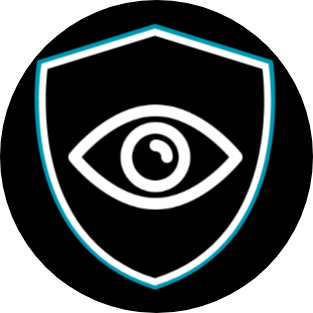

<p align="center">
  
</p>

<h1 align="center">Observer</h1>

<p align="center"><strong>A calmer way to manage your Discord community.</strong></p>

Observer brings moderation, server safety, and community tools together in a configurable Discord bot, supported by a web dashboard for the people who run your server.

<p align="center"><a href="https://observer-dashboard.observer/"><strong>Visit the Observer website and dashboard →</strong></a></p>

> Observer is actively developed. Features and configuration may change as the project grows.

## What Observer can do

- **Moderation and records:** moderation commands, cases, statistics, and audit logs help staff keep track of actions.
- **Server safety:** scam message and link checks, join-burst and honeypot protections, and image scanning with OCR, QR decoding, and trained fingerprints.
- **Reports and tickets:** message reports, anonymous reporting, support tickets, and workflows for staff.
- **Community tools:** reaction roles, rules, tags, leveling, temporary voice channels, reminders, and more.
- **Flexible configuration:** configure individual server features and settings from the dashboard, with an in-server setup interface available as a backup.

Feature availability depends on configuration, Discord permissions, and the version being run.

## Get started

1. Visit the [Observer website](https://observer-dashboard.observer/) and sign in with Discord.
2. Choose an eligible server and follow the option to add Observer if it is not already there.
3. Open the server's configuration page on the dashboard and choose the settings and features that fit your community.
4. Invite your staff to use the moderation tools available to them, and check that Observer has the Discord permissions needed for your chosen features.

If you need to configure Observer in Discord, use `/setup` as an alternative.

## The dashboard

The website gives server owners and authorized staff a place to work with Observer:

- **Server configuration** for owners to manage supported settings and features.
- **Reports and moderation** for authorized moderators to review activity and handle reports.
- **Custom messages** to create, send, and edit supported embeds and cards.
- **Discord sign-in and server selection** to find the communities you can manage.

The options available depend on your access and whether Observer is present in the server.

## Permissions and privacy

Observer's official invite asks Discord for a set of feature permissions; it does **not** request Administrator. You can review the requested permissions on Discord's authorization screen and restrict the bot's role or channel access afterward. Give it only what you are comfortable with: features that need a permission may not work if it is removed.

| Permission | Why it may be needed |
| --- | --- |
| View Channels, Send Messages, Embed Links, Attach Files, and Read Message History | Let Observer respond, post reports and logs, send formatted messages or attachments, and retrieve messages for supported features in channels it can access. |
| Add Reactions | Supports reaction-based interactions such as reaction roles. |
| Manage Messages | Allows supported moderation and safety features to remove messages. |
| Kick Members, Ban Members, and Moderate Members | Allow authorized moderation actions, including kicks, bans, and timeouts. |
| Manage Roles | Assigns and removes roles for features such as reaction roles and verification; Discord's role hierarchy still applies. |
| Manage Channels and Move Members | Support channel-based tools such as temporary voice channels and moving members into them. |
| View Audit Log | Helps audit logging identify who performed certain server actions. |
| Send Messages in Threads | Lets Observer send messages in accessible threads. |

The current invite also requests **Create Instant Invite, Manage Server, Connect, Speak, Mute Members, Deafen Members, Change Nickname, Manage Nicknames, Manage Webhooks, Create Public Threads, Create Private Threads, and Use External Stickers**. Their necessity for the currently loaded features has not been fully verified; review these particularly carefully and remove any your server does not need. Discord permissions and channel overrides control what the bot can do, and you can change them or remove the bot at any time.

**What Observer can access:** Message-based safety and reporting features depend on access to messages and, for image checks, attachments in channels the bot can see. Moderation records, server settings, and feature state are stored by the bot. Dashboard sign-in requests Discord's `identify` and `guilds` scopes to identify your account and find eligible servers; signing in does not give Observer your Discord password. Review the website's privacy information and your server's configuration before enabling features. The code includes a public report feed that can expose report reasons without identities; review that behavior and avoid placing sensitive information in report reasons.

You can inspect the bot's source in this repository and adjust its permissions to suit your community. Source availability and permission controls help you make an informed choice; they are not a guarantee that the software is free of bugs.

## Running your own bot

You can run your own copy of the bot under the [Observer Source License](LICENSE). The website and dashboard have separate, restricted terms; see [Licenses](#licenses).

1. Create a bot application in the [Discord Developer Portal](https://discord.com/developers/applications). Enable the Server Members, Message Content, and Presence privileged intents and invite the bot with the permissions its enabled features require.
2. Clone this repository, create and activate a Python virtual environment, and install dependencies:

   ```bash
   git clone https://github.com/blurock2/Observer-cogs.git
   cd Observer-cogs
   python -m venv .venv
   ```

   Activate with `source .venv/bin/activate` on Linux/macOS or `.venv\Scripts\activate` on Windows, then run:

   ```bash
   pip install -r requirements.txt
   ```

3. Copy `.env.example` to `.env` and set `DISCORD_TOKEN` and `BOT_OWNER_ID`. Keep your token and other secrets private.
4. Start the bot with `python bot.py` and use `/setup` in your server to configure your instance.

Image scam scanning requires Tesseract installed separately and available on your PATH. The application bridge is for the creator's private desktop app, which is not publicly available; it is not needed to use Observer. Some owner-only and support-related functions exist; if you use them, manually select or configure your own support or home server. Review instance-specific settings before deployment.

For persistent VPS hosting, see the files in `deploy/`. Back up your databases and keep runtime data and secrets out of version control.

## Development and contributions

The bot is built with Python and discord.py using modular extensions. Bug reports, suggestions, and improvements are welcome. Keep changes modular, preserve per-server configuration, and add or update tests where appropriate. After installing the project dependencies, run:

```bash
pytest
ruff check .
```

Website and dashboard code is subject to the separate restrictions below.

Observer is an independent project and is not affiliated with or endorsed by Discord Inc.

## Licenses

**Bot code:** The custom [Observer Source License](LICENSE) allows use, modification, and redistribution with attribution, subject to its restrictions on malicious use. It is source-available, not an OSI-approved open-source license.

**Website and dashboard:** Copyright belongs to Observer's creator. The website and dashboard are reserved for Observer and may not be copied, modified, deployed, or otherwise used by others without the creator's specific permission. Normal use of the official website by its visitors is allowed. See the [Observer Website License](WEBSITE-LICENSE).

<p align="center">
  <a href="https://ko-fi.com/supporting_observer"></a>
  <a href="https://discord.gg/tccYb2XSxR"></a>
</p>
